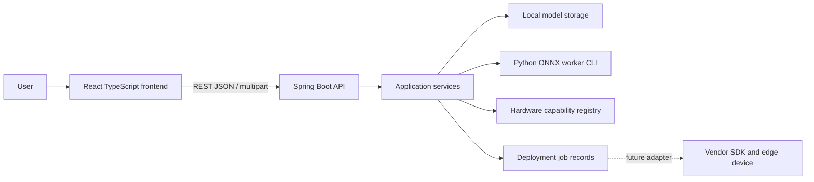

# Architecture

## Components

The React/Vite frontend calls Spring Boot REST APIs. Spring owns request validation, application services, local model storage, and deployment job lifecycle. The Python worker is a separately runnable package responsible only for ONNX validation and metadata extraction. It is not an HTTP service and is not part of the Java runtime. Future hardware adapters own vendor compiler/runtime interactions.

## Upload and inspection

The frontend posts a multipart ONNX file to `POST /api/v1/models`. Spring enforces configured size and `.onnx` type limits, writes the file to a controlled directory outside web roots, computes a SHA-256 digest, and then inspects it through `ModelInspector`. `LocalProcessModelInspector` invokes the worker CLI with an argument vector and a bounded timeout, reads capped JSON on stdout, and never uses a shell. Accepted uploads persist `metadata.json` beside the stored model so the local catalog survives process restarts without PostgreSQL; an inspection failure is recorded as `INVALID` with its safe code and message, rather than deleting the uploaded file.

Worker validation checks size, ONNX parsing/checker validity, and extracts graph input/output names, element types, and dimensions. It does not execute uploaded models. Errors are structured and should not disclose local paths.

`GET /api/v1/models` returns stored model identity, digest, timestamps, validation status, and inspection metadata when validation succeeds. File paths are not exposed.

## Compatibility check V1

`GET /api/v1/hardware` exposes the initial configurable NVIDIA Jetson Orin Nano Super profile. `POST /api/v1/models/{modelId}/compatibility-check` consumes the stored worker analysis rather than re-parsing the model, deterministically checks operators, input/output precision, dynamic input shapes, and the configured default-domain opset range, then persists the latest result as `compatibility.json` beside that model. A result is `INCOMPATIBLE` for blocking findings, `WARNING` for dynamic shapes, otherwise `COMPATIBLE`. This is static compatibility analysis only; it does not build TensorRT engines or run on hardware.

## API and persistence

Spring Web controllers delegate to services and return JSON. `/health` is an infrastructure-friendly status response. Hardware, compatibility report, and deployment list endpoints currently return empty arrays. `GET /api/v1/compatibility-reports` returns HTTP 200 with `{"data": []}` through the catalog service; report generation, compatibility evaluation, and PostgreSQL persistence remain planned. Datasource/JPA auto-configuration is excluded until those records exist. CORS is configured for the local Vite origin in application configuration, and the Vite dev server proxies `/api` to the API.

The worker inspection result includes file size, ONNX IR version, opsets, input/output tensors (name, element type, and shape), distinct operators, per-operator node counts, and a parameter count. Parameter count is the sum of dense graph-initializer elements; it does not execute the model or load external tensor data. Persisted model records add model identity and a backend-computed file digest. Compatibility reports should identify model, target, runtime, status, reasons, and evidence/source. Unknown capability must remain unknown; parse success alone is not a compatibility result.

## Jobs

Planned lifecycle: `QUEUED → VALIDATING → PREPARING → SUCCEEDED|FAILED`; hardware deployment states are future additions. Each transition is recorded, errors are actionable, and no state claims compilation/device deployment until an adapter actually performs it. Current list returns no jobs.

## Errors and security

Use stable JSON errors with code, message, and optional field details. Validate request DTOs and map validation failures centrally. Uploads are untrusted: enforce byte limits, verify structure, avoid unsafe deserialization or execution, isolate storage, sanitize output, and keep secrets out of logs. Authorization and retention policy are required before production uploads.

## Future integration

The `ModelInspector` abstraction is the Java boundary for worker invocation. Hardware capability providers and vendor adapters are separate interfaces added only when a target/SDK is selected. No broker or distributed infrastructure is needed for the initial workflow.
