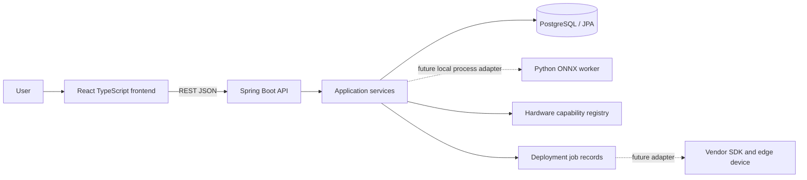

# Architecture

## Components

The React/Vite frontend calls Spring Boot REST APIs. Spring owns request validation, application services, metadata persistence, and deployment job lifecycle. The Python worker is a separately runnable package responsible only for ONNX validation and metadata extraction. It is not an HTTP service and is not part of the Java runtime. Future hardware adapters own vendor compiler/runtime interactions.

## Upload and inspection

Planned upload flow: frontend posts a multipart ONNX file to Spring. Spring enforces configured size/type limits, writes it to controlled storage, and requests inspection through the Java `ModelInspector` interface and its `ModelInspection` result records. A future `LocalProcessModelInspector` can invoke the worker CLI using an argument vector and a bounded timeout, exchange JSON on stdin/stdout, and never invoke a shell. The initial backend scaffold has no upload endpoint or process invocation. The worker exposes Python functions and a JSON CLI contract only; the Java boundary is currently interface-only.

Worker validation checks size, ONNX parsing/checker validity, and extracts graph input/output names, element types, and dimensions. It does not execute uploaded models. Errors are structured and should not disclose local paths.

## API and persistence

Spring Web controllers delegate to services and return JSON. `/health` is an infrastructure-friendly status response. List endpoints currently return empty arrays. JPA/PostgreSQL is configured for subsequent metadata/job persistence; no placeholder entities are created. CORS is configured for the local Vite origin in application configuration.

The worker inspection result includes file size, ONNX IR/opsets, and input/output tensors (name, element type, and shape). A future persisted model record should add model identity and a backend-computed file digest. Compatibility reports should identify model, target, runtime, status, reasons, and evidence/source. Unknown capability must remain unknown; parse success alone is not a compatibility result.

## Jobs

Planned lifecycle: `QUEUED → VALIDATING → PREPARING → SUCCEEDED|FAILED`; hardware deployment states are future additions. Each transition is recorded, errors are actionable, and no state claims compilation/device deployment until an adapter actually performs it. Current list returns no jobs.

## Errors and security

Use stable JSON errors with code, message, and optional field details. Validate request DTOs and map validation failures centrally. Uploads are untrusted: enforce byte limits, verify structure, avoid unsafe deserialization or execution, isolate storage, sanitize output, and keep secrets out of logs. Authorization and retention policy are required before production uploads.

## Future integration

The `ModelInspector` abstraction is the Java boundary for worker invocation. Hardware capability providers and vendor adapters are separate interfaces added only when a target/SDK is selected. No broker or distributed infrastructure is needed for the initial workflow.
