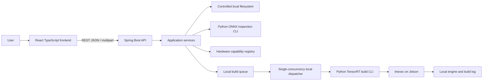
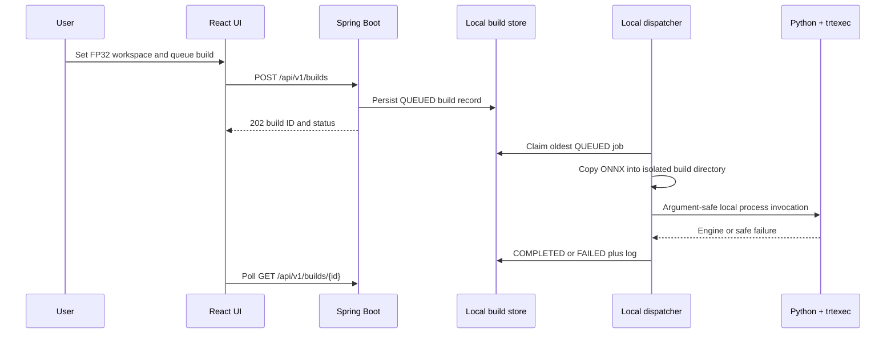

# Architecture

## Scope and deployment model

This is a **local-first** architecture. The React application calls a Spring Boot API on the same development network. Model metadata, compatibility results, build records, engines, and logs are stored on controlled local filesystem paths. A real TensorRT build requires the API process to run on a compatible NVIDIA Jetson; that is the supported current arrangement.

AWS services, S3, SQS, public artifact URLs, and cloud credentials are not part of the current runtime. They are future adapters, not hidden requirements.

## Components

Spring owns REST validation, model/build orchestration, and local persistence. The Python package exposes two bounded command-line interfaces: safe ONNX inspection and TensorRT engine construction. It is invoked as a subprocess with an argument vector; it is not an HTTP service and never executes an uploaded ONNX graph.

| Component | Responsibility | Does not do |
| --- | --- | --- |
| React/Vite | Upload, compatibility/build controls, status polling | Compile models or make compatibility decisions |
| Spring Boot | Request validation, local records, queue ownership, process orchestration | Parse ONNX graphs or run TensorRT itself |
| Python ONNX worker | Parse and validate untrusted ONNX without execution | Infer hardware compatibility from parsing alone |
| Python TensorRT worker | Invoke `trtexec` safely and require a non-empty engine | Validate inference correctness or benchmark performance |
| Jetson + JetPack/TensorRT | Provide the target GPU, drivers, CUDA, and TensorRT toolchain | Guarantee portability to other Jetsons or TensorRT versions |

## Upload and inspection

The frontend posts a multipart ONNX file to `POST /api/v1/models`. Spring enforces configured size and `.onnx` type limits, writes the file to a controlled directory outside web roots, computes a SHA-256 digest, and inspects it through `ModelInspector`. `LocalProcessModelInspector` invokes the worker CLI with an argument vector and a bounded timeout, reads capped JSON on stdout, and never uses a shell.

Accepted uploads persist `metadata.json` beside the stored model so the local catalog survives process restarts. An inspection failure is recorded as `INVALID` with a safe code and message rather than deleting the uploaded file. The worker checks ONNX parsing/checker validity and extracts graph interface, opsets, operators, operator counts, and dense-initializer parameter count. It does not execute the graph.

`GET /api/v1/models` returns model identity, digest, timestamp, validation status, and inspection metadata. It never exposes filesystem paths.

## Compatibility check V1

`GET /api/v1/hardware` exposes the initial NVIDIA Jetson Orin Nano Super profile. `POST /api/v1/models/{modelId}/compatibility-check` consumes stored analysis rather than parsing the ONNX file again. Deterministic rules check the configured operator allow-list, input/output precision, dynamic input shapes, and default-domain opset range.

The latest result is stored as `compatibility.json` beside the model. `INCOMPATIBLE` is returned for blocking findings; `WARNING` is returned for non-blocking concerns such as dynamic shapes; otherwise the result is `COMPATIBLE`. This is static compatibility analysis only, not proof of a TensorRT build or Jetson execution.

## API and local persistence

Spring Web controllers delegate to services and return JSON. `/health` is an infrastructure-friendly status response. CORS is configured for the local Vite origin and the Vite server proxies `/api` during development. JPA/datasource auto-configuration remains disabled: PostgreSQL dependencies are present, but the current implementation deliberately persists only to local files.

| Data | Default local location | Contents |
| --- | --- | --- |
| Model | `uploads/models/<model-id>/` | `model.onnx`, `metadata.json`, optional `compatibility.json` |
| Build record | `uploads/builds/<build-id>.json` | Request snapshot and current safe status/message |
| Build working directory | `uploads/builds/<build-id>/` | Isolated ONNX copy, `model.engine` on success, and `build.log` |

The API does not expose filesystem paths. There is not yet an artifact-download endpoint; local operators retrieve completed artifacts from the controlled build directory.

## Local build queue and TensorRT execution

`POST /api/v1/builds` creates a `QUEUED` request only when all of the following are true:

- The model exists, is `VALID`, and has inspection data.
- The target hardware exists and the latest compatibility result is for that target and is not `INCOMPATIBLE`.
- Inputs have known, positive static shapes.
- Precision is `FP32`; FP16 and INT8 are intentionally rejected in V1.
- Workspace is within the configured bound.

`WARNING` compatibility is allowed with a visible UI caution. It is neither a build guarantee nor runtime verification.

The dispatcher is disabled by default and processes one job at a time. When enabled, it launches the configured Python command with the copied model path, engine output path, and workspace size. The CLI invokes `trtexec` with `shell=False`, accepts no user-controlled flags, requires a non-empty engine, and reports a failure if the process is unavailable, times out, exits unsuccessfully, or does not create an engine.

| Status | Meaning |
| --- | --- |
| `QUEUED` | Valid request stored; waiting for the enabled local dispatcher |
| `BUILDING` | Single local worker claimed the request and started preparation/TensorRT |
| `COMPLETED` | A non-empty local engine was produced; runtime inference is **not** verified |
| `FAILED` | Local setup, timeout, TensorRT, or artifact verification failed |

Relevant endpoints are `POST /api/v1/builds`, `GET /api/v1/builds/{buildId}`, and `GET /api/v1/models/{modelId}/builds`. The UI polls the read endpoint while a job is non-terminal.

## Configuration and operator setup

| Setting | Default | Purpose |
| --- | --- | --- |
| `APP_BUILD_ENABLED` | `false` | Enables the dispatcher only on a prepared Jetson |
| `APP_BUILD_EXECUTABLE` | `python` | Python interpreter with `onnx_worker` installed |
| `APP_BUILD_DIRECTORY` | `uploads/builds` | Controlled local build record/artifact root |
| `APP_BUILD_MAX_WORKSPACE_MI_B` | `1024` | Maximum accepted TensorRT workspace request |
| `APP_BUILD_TIMEOUT` | `30m` | Process timeout for one build |

To operate it, install JetPack/TensorRT on the Jetson, ensure `trtexec` is on `PATH`, install the worker package in the selected Python environment, set `APP_BUILD_ENABLED=true`, and start the backend on that machine. Do not enable the dispatcher on a general development workstation merely to simulate success: it will fail safely if TensorRT is unavailable.

## Security and accuracy boundaries

Use stable JSON errors with code, message, and optional field details. Uploads are untrusted: enforce byte limits, verify structure, avoid unsafe deserialization or execution, isolate storage, sanitize output, and keep secrets out of logs. TensorRT receives only backend-created paths and bounded numeric options; users cannot supply shell fragments, custom plugins, or arbitrary TensorRT flags.

The current local application has no authentication, ownership enforcement, retention policy, cancellation, multi-worker coordination, artifact download API, external ONNX-data support, or runtime inference validation. It is appropriate for a controlled single-operator environment, not multi-user production exposure.

`COMPLETED` means only that `trtexec` created a non-empty engine in the configured local environment. Engine portability depends on the target GPU, TensorRT/JetPack versions, plugins, and build options. It does not mean the engine has executed successfully or meets any performance target.

## Future evolution

The `ModelInspector` and local build CLI are process boundaries that permit later replacement without changing the UI contract. Future work can add PostgreSQL-backed records, authenticated ownership, artifact downloads, cancellation/retry, runtime validation, and a remote Jetson pull worker. An optional cloud adapter can later replace local artifact and dispatch storage with S3/SQS or equivalent, but it must preserve the same validation, private artifact access, idempotent state transitions, and conservative runtime claims.
